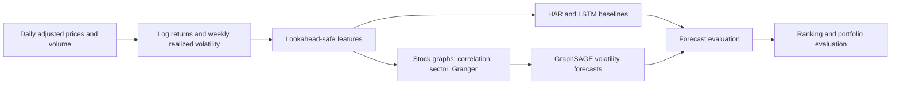
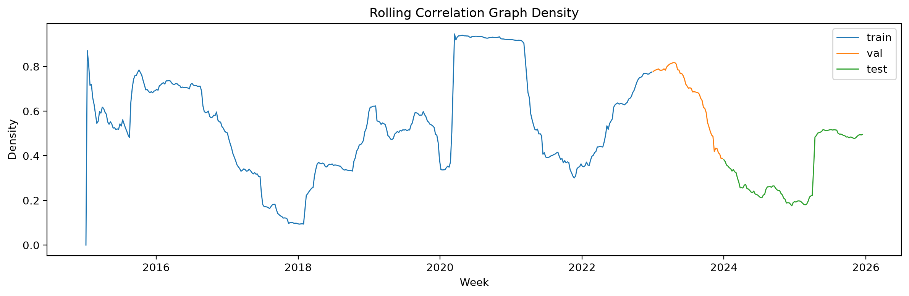
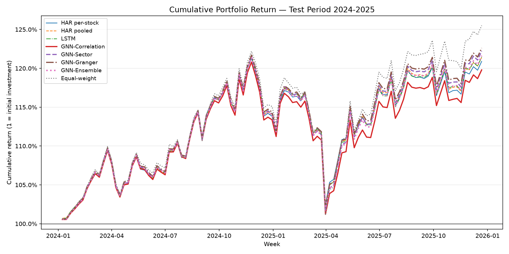
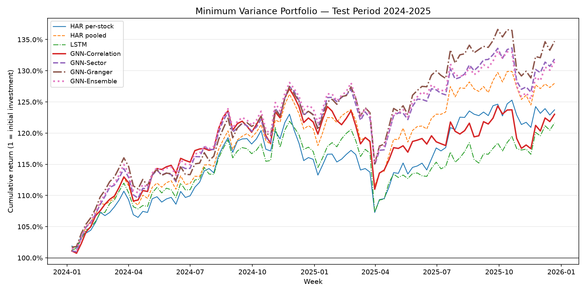

# Volatility GNN

### Do Better Volatility Forecasts Lead to Better Portfolios?

**Evidence from Graph Neural Networks**

This project tests whether graph neural networks (GNNs) can improve one-week-ahead realized-volatility forecasts for S&P 500 stocks—and whether any forecast improvements lead to better portfolio outcomes. Stocks are represented as nodes, and relationships between stocks are represented as edges in correlation, sector, or Granger-predictive graphs.

The central finding is nuanced: a correlation GNN has the lowest saved test-set mean squared error, while an ensemble has the strongest saved cross-sectional ranking score. Those forecasting results do not translate into a universal portfolio advantage. In the saved long-only comparison, equal weighting has the highest Sharpe ratio among the evaluated strategies; graph-based models perform better in the minimum-variance comparison. Results depend on the portfolio construction method.

> The values and figures below summarize the result files available in the project workspace when this README was prepared. Re-run the notebooks to reproduce them. Market data, model checkpoints, and most generated result files are excluded from Git.

## Project at a glance

- **Universe:** S&P 500 constituents retrieved from Wikipedia, filtered for at least 95% price-data coverage over the study period. The saved run represented in the figures contains 460 stocks.
- **Study period:** Daily market data from 2015–2025, converted to weekly observations.
- **Target:** Annualized realized volatility during the following week.
- **Split:** Training through 2022, validation in 2023, and testing in 2024–2025.
- **Graph types:** Rolling return-correlation graphs, annual sector graphs, and directed Granger-predictive graphs estimated using training-period data.
- **Comparisons:** HAR baselines, an independent-stock LSTM, graph neural networks, and an inverse-validation-error GNN ensemble.

## Research pipeline



## Figures

### Rolling correlation graph density

The correlation graph changes over time as the strength and number of stock relationships change. Edges connect stocks whose absolute return correlation exceeds the configured threshold, using a rolling estimation window.



### Long-only portfolio comparison

The chart compares cumulative returns from inverse-volatility-weighted portfolios built using each model's forecasts with an equal-weight benchmark. In the saved run, equal weighting finishes ahead of the GNN long-only strategies.



### Minimum-variance portfolio comparison

Portfolio results depend on how forecasts are used. In the saved minimum-variance comparison, the Granger GNN has the highest reported Sharpe ratio among the evaluated models.



## Saved result highlights

| Evaluation | Top result in the saved run | Value |
|---|---|---:|
| Test-set MSE | GNN-Correlation (threshold 0.3) | 0.03197 |
| Test-set MAE | LSTM | 0.10971 |
| Directional accuracy | LSTM | 70.9% |
| Mean weekly Rank IC | GNN-Ensemble | 0.44384 |
| Long-only Sharpe ratio | Equal-weight benchmark | 0.53880 |
| Minimum-variance Sharpe ratio | GNN-Granger | 0.95952 |

MSE and MAE are computed over stock-week observations. Rank IC measures how well a model orders stocks by future volatility each week. Portfolio metrics are annualized over the test period and should be interpreted with the portfolio assumptions and transaction costs in the relevant notebook. A strong forecast metric is not, by itself, evidence of a profitable or deployable investment strategy.

## Methods

### Target and features

Daily log returns are used to calculate annualized realized volatility. The target for each stock is the realized volatility of the next week. Features are aligned to information available by the end of the forecast week and include:

- Realized-volatility estimates over 5-, 10-, 21-, and 63-trading-day windows, plus a short-to-long volatility ratio.
- 5- and 20-day cumulative returns.
- 5- and 20-day average trading volume, plus a volume ratio.

Features are winsorized and z-scored cross-sectionally. The notebooks also explore macroeconomic and market-regime features.

### Models and graphs

- **HAR:** Per-stock and pooled heterogeneous autoregressive baselines.
- **LSTM:** A separate sequence model for each stock's feature history.
- **Correlation GNN:** GraphSAGE over a rolling graph of stocks with sufficiently correlated returns.
- **Sector GNN:** GraphSAGE over sector membership graphs.
- **Granger GNN:** GraphSAGE over directed, training-period Granger-predictive relationships.
- **Extensions:** Rank-based loss, macro features, alternative correlation windows, hyperparameter searches, and a volatility-based Granger graph.

Granger edges indicate predictive precedence under the chosen statistical procedure; they should not be interpreted as proof of structural or economic causation.

### Evaluation

Forecast accuracy is evaluated using MSE, MAE, and R². Cross-sectional usefulness is evaluated using weekly Spearman Rank IC, top-k hit rate, and pairwise ranking accuracy. Portfolio notebooks compare forecast-driven strategies—including inverse-volatility weighting and minimum variance—with benchmarks, turnover, drawdown, and transaction-cost assumptions.

## Repository layout

```text
.
├── config.py                 # Shared experiment settings and data paths
├── src/                      # Data, features, graphs, models, training, evaluation
├── notebooks/                # End-to-end workflow and experiment notebooks
├── docs/assets/figures/      # README figures
├── pyproject.toml            # Python dependencies and project configuration
└── uv.lock                   # Locked dependency versions
```

### Notebook guide

| Notebook | Purpose |
|---|---|
| `01_data.ipynb` | Download prices and build the stock universe and weekly volatility target |
| `02_features.ipynb` | Build and inspect forecasting features and time splits |
| `03_graphs.ipynb` | Construct and inspect correlation, sector, and Granger graphs |
| `04_baseline_models.ipynb` | Fit HAR baselines |
| `04_gnn_models.ipynb` | Train and compare core GNN models |
| `04b_gnn_hparam_search.ipynb` | Search GNN hyperparameters |
| `04b_gnn_hparam_search_multi_windows.ipynb` | Compare macro-GNN settings across feature windows |
| `04c_rank_loss_models.ipynb` | Explore ranking-oriented losses |
| `04d_macro_models.ipynb` | Add macroeconomic and regime features |
| `04e_corr_window_models.ipynb` | Compare correlation graph windows |
| `04f_volatility_granger_models.ipynb` | Explore volatility-based Granger graphs |
| `05_evaluate.ipynb` | Evaluate forecasts on the held-out test period |
| `06_portfolio.ipynb` | Simulate forecast-driven portfolio strategies |
| `08_final_results.ipynb` | Consolidate final result tables and plots |

## Reproducing the workflow

The project uses Python 3.10 or 3.11 and `uv` for dependency management. The current `pyproject.toml` pins CUDA 12.1 PyTorch wheels, intended for a compatible NVIDIA/CUDA environment. On macOS or a CPU-only machine, use platform-compatible PyTorch and PyTorch Geometric packages before syncing the remaining dependencies.

1. Install Python 3.10 or 3.11 and `uv`.
2. Install dependencies appropriate for your operating system and available hardware.
3. Launch Jupyter Lab from the project environment.
4. Run the notebooks in workflow order, starting with data, features, and graphs. Run optional experiment notebooks as needed, then evaluation and portfolio analysis.

The data notebooks download current S&P 500 constituents and market data from external sources. Results can therefore change as those sources and their historical coverage change. Generated data, checkpoints, and result tables are stored under `data/` and are gitignored; they are not included in a fresh clone.

## Limitations

- The universe is based on the **current** S&P 500 constituent list rather than a point-in-time membership history. This can introduce survivorship bias.
- Historical prices and company classifications come from external data providers and may be revised or unavailable.
- Granger relationships depend on sample period, lag choice, and multiple-testing correction; they are statistical forecasting features, not causal conclusions.
- Portfolio performance is sensitive to the construction method, constraints, costs, and test window. The reported backtests are research experiments, not investment advice or evidence of live-trading performance.
- Generated outputs are not committed, so reproducing the saved figures and metrics requires rerunning the notebooks and obtaining compatible data access and compute resources.

## License

No license is currently included. All rights reserved unless a license is added to this repository.
